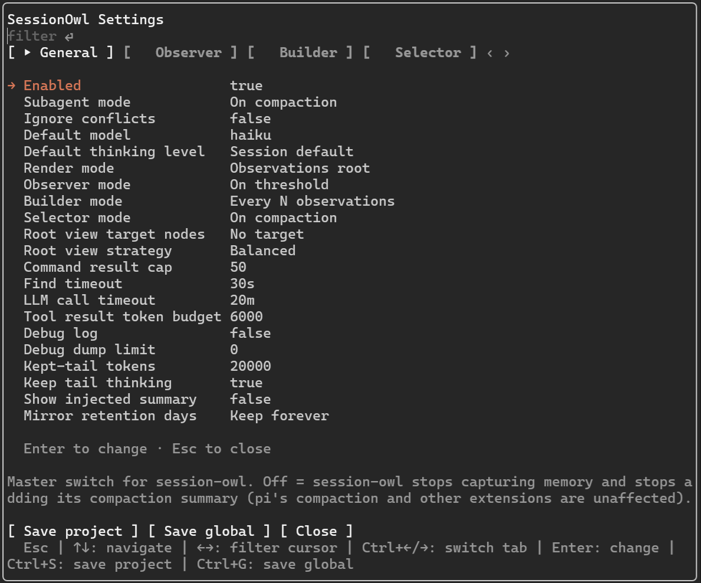
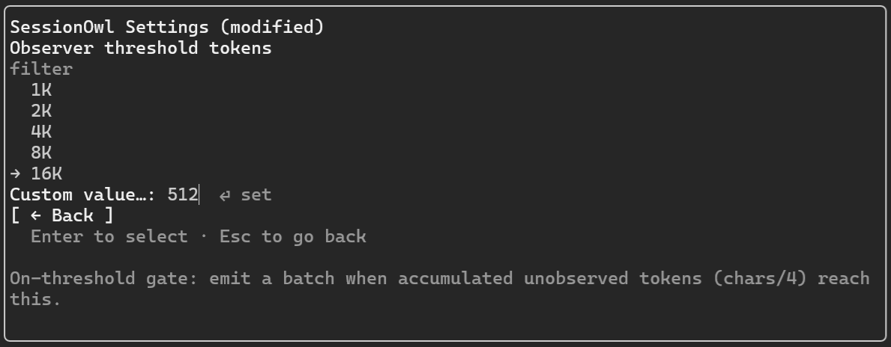

# avtc-claude-settings-ui

A schema-driven settings UI for Claude mods — define your settings, get a tabbed pane, a /<name>-settings command, and layered persistence.

## Features

- **Schema-driven** — define settings once in a typed schema; the library renders and validates them automatically
- **Tabbed layout** — group settings into tabs; each tab renders as a separate panel; `Ctrl+Left`/`Ctrl+Right` switch tabs
- **Typed settings** — string, number, duration, compact-threshold, boolean, model, thinking-level types with presets, optional `min`/`max` bounds, and custom type support
- **Layered persistence** — choose your storage levels via `storageLevels` (`session`, `project`, `global`; default: all three); when `session` is included, settings are also serialized to the env var for subagent propagation and reload survival; edits draft until an explicit save — **Save project** / **Save global** footer buttons (`Ctrl+S` saves project, `Ctrl+G` saves global)
- **Dirty tracking** — the pane tracks what changed; with multiple levels, edits draft until an explicit save to the level you pick
- **Filter-first lists** — type to filter every list by substring (over label + value); `Enter` opens the value picker
- **Keyboard navigation** — the filter input holds focus; arrows walk the items (`Enter` opens the value picker, `Esc` closes the pane)
- **Value normalization** — every value is validated against the schema before it's saved

The settings pane on Claude Code — tabbed panels, the filter-first list:



A value picker open on a row:



## Installation

```bash
npm install avtc-claude-settings-ui
```

Inside a mod's hooks closure, consume it via a relative import (the hooks loader resolves relative paths only):

```js
import { createSettingsExtension } from "../node_modules/avtc-claude-settings-ui/dist/index.js";
```

## Usage

```js
import {
  createSettingsExtension,
  createPaneController,
  buildPaneTree,
  settingsFilePaths,
} from "avtc-claude-settings-ui";

const schema = {
  ...settingsFilePaths("my-mod"),
  tabs: [{ label: "General", settingIds: ["enabled"] }],
  settings: [{ id: "enabled", label: "Enabled", type: "boolean", defaultValue: true }],
};

on("session.start", async (e, next) => {
  // `$.fs`/`$.env` themselves cannot be passed as values — each method
  // is wrapped in a closure:
  const fs = {
    read: (path) => $.fs.read(path),
    write: (path, text) => $.fs.write(path, text),
  };
  const env = {
    get: (name) => $.env.get(name),
    set: (name, value) => $.env.set(name, value),
  };
  const notify = {
    message: (text) => $.ui.log(text),
    warn: (text) => $.ui.log(text),
  };
  const cwd = typeof e.cwd === "string" ? e.cwd : "";
  const cfgDir = await $.env.get("CLAUDE_CONFIG_DIR");
  const home = await $.env.get("HOME");
  const globalDir = cfgDir && cfgDir.length > 0 ? cfgDir : `${home}/.claude`;

  const handle = createSettingsExtension(schema, { fs, env, envVar: "CLAUDE_SETTINGS_MY_MOD" });
  await handle.load(cwd, globalDir);

  const controller = createPaneController(handle, {
    title: "My Settings",
    notify,
    storageLevels: handle.storageLevels,
    cwd,
    onClose: () => {}, // wired to the host's pane-close
    onInvalidate: () => {}, // wired to the host's repaint
  });
  await controller.prepare(); // resolves function presets once

  return next(e);
});

// In the ui.render Pane hook:
const els = $.ui.resolve(e);
const tree = buildPaneTree(els, controller, { bodyColumns: e.props.bodyColumns });
```

## API

| Export | Description |
|--------|-------------|
| `createSettingsExtension(schema, seams)` | The data layer: load/normalize/validate/save over injected `fs`/`env` seams |
| `createPaneController(handle, options)` | The pane's interaction model (tabs, dirty tracking, save actions) |
| `buildPaneTree(els, controller, options)` | Composes the render tree over the surface's element table |
| `settingsFilePaths(name)` | Global/project file path helpers for the schema |
| `registerSettingsCommand`, `loadSettingsHandle` | Wiring a `/name-settings`-style command and lazy handle load |
| `registerTypeDefinition` | Custom setting types |
| Types | `SettingsSchema`, `SettingSchema`, `SettingsTabSchema`, `FsAdapter`, `EnvStore`, `PaneController`, `PaneTreeOptions`, … |

## Setting types

Every setting has a `type` resolved through a first-class `TypeDefinition` registry. Seven built-ins ship out of the box:

| Type | Stored value | Notes |
|------|-------------|-------|
| `string` | `string` | Text; closed enums via presets (`["a", "b"]`), or free-form with `supportsCustomValues: true` |
| `number` | `number` \| `null` | Optional `min`/`max` bounds; `null` (unbounded/off) via a null preset |
| `duration` | `number` \| `null` | Human-readable (`5m`, `1h`, `30s`, `14d`); stored as milliseconds. `null` = unbounded/off, via a null preset |
| `compact-threshold` | `string` | Compact-context thresholds (`none`, `compact`, `compact>75K`, …) |
| `boolean` | `boolean` | `true`/`false`; presets `[true, false]` |
| `model` | `string` \| `null` | Model id, stored verbatim in the form the surface accepts (on Claude: the engine's model id); presets from the host-provided model list. Nullable via a `["Default", null]` preset |
| `thinking-level` | `string` | Thinking level (label equals value) |

A `presets` array can hold full `[label, value]` pairs or bare values (`"a"`, `5`, `true`, `null`); a bare value pairs with itself, except a duration string which parses to milliseconds.

**Custom types:** register your own via `registerTypeDefinition(def)` and reference it as `type: "<def.id>"`. A `TypeDefinition` declares how values parse/format and optional `presets`; null support comes from including a null-valued preset (e.g. `["Off", null]`).

## Storage

| Level | Lives in |
|---|---|
| Session | in-memory (serialized to the env var for subagent propagation + reload survival) |
| Global | `<globalDir | ~/.claude>/<name>-settings.json` |
| Project | `<cwd>/.claude/<name>-settings.json` |

Load layering: env var (session propagation) → defaults → global → project (only the keys present in the project file).

**How edits save:** with a single file level (`global` or `project`, no session), each edit writes straight to that file. With multiple levels (or `session`), edits are held as an in-memory draft until an explicit save — the **Save project** / **Save global** footer buttons (`Ctrl+S` saves project, `Ctrl+G` saves global; `Esc` closes).

## Full suite

Check out the full suite of related extensions, [avtc-pi](https://github.com/avtc/avtc-pi) — deterministic feature development, subagent delegation, working-memory, behavioral learning, parallel-work guardrails, durable decisions, notifications, and more.

Developed with [Z.ai](https://z.ai/subscribe?ic=N5IV4LLOOV) — get 10% off your subscription via this referral link.

## License

MIT
